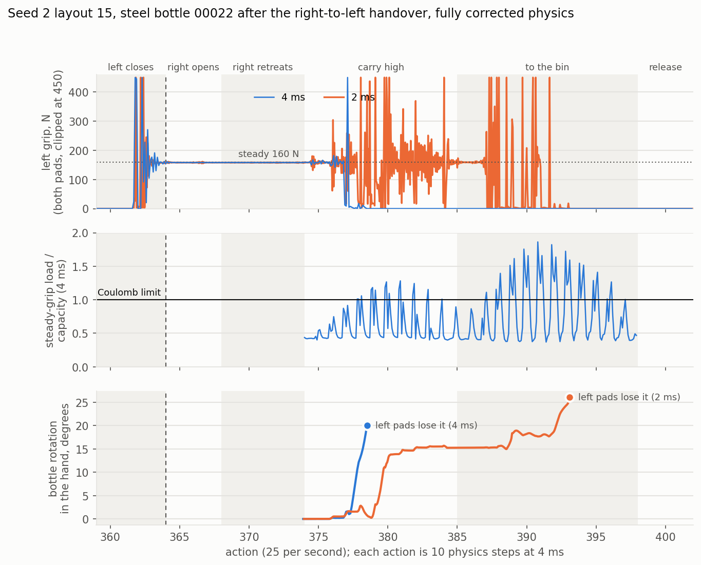

# Handover diagnosis for the corrected bottle task

**State (November 14, 2026, 05:50 EST): done, 1.14 of the 1.5 GPU-hours.** Question (Bo, PR #153): at fully corrected physics, steel bottle 00022 (0.22 kg) leaves the left hand right after the right-to-left handover in seed 2 layouts 11, 14 and 15. Is that a real slip (the grasp cannot hold), an artefact of the script's timing (the giver opens before the receiver has clamped, the script having been written under shipped's faster gripper), or a solver artefact? Predictions were committed before every batch (`PREDICTIONS.md`, with outcomes).

## Answer

**Neither timing nor a real slip; the simulated grip lets go.**

- **Not timing.** In every 00022 handover the receiver is at its 80 N per pad cap 88 to 96 ms (22 to 24 steps) before the giver opens; both grippers hold the bottle at the open. The bottle then sits still in the left hand for 2 actions (layout 11) or 11 (layouts 14, 15). Waiting for the cap before opening (a) inserts no action and changes nothing, row for row (as built it can only wait for contact, but at every open the pads already press 76 to 85 N). Shipped's faster closing (b) moves the cap 28 ms earlier and loses 00022 in all three layouts.
- **Not a failure of the grasp at its applied force.** From the logged contacts, 80 N per pad on 00022 gives a torsion capacity of 0.31 to 0.32 N m and a tangential capacity of 50 N, against a 2.16 N weight on a 34 mm lever: static margins of 4.2 to 4.4 and 23. Bo's intuition is right. The margin is eaten by two things. The pad normals are tilted 13 to 17 degrees on the steel bottle's hull, so their wedge uses 42% of the tangential capacity at rest. And RoboDojo's 25 Hz re-aiming jerks the hand at every action boundary (up to 60 to 70 m/s², 220 to 360 rad/s²). With a steady grip, those peaks exceed the torsion capacity from action 378 on (up to 1.3 times in the carry, 1.9 in the bin swing), never the tangential one (at most 0.71). The predicted behaviour is a pivot in the hand, not a drop. Shipped's weaker gripper, steady at about 24 N per finger, shows exactly that: 00022 pivots 21 degrees and is carried to the release (e).
- **What drops it: the corrected gripper's grip collapses and chatters (#160).** At action 377, substep 9 (layouts 14, 15), where a steady grip would sit at 0.75 to 0.81 of its capacity, both pads' force falls from 78 N to near 0 in one 4 ms step. It then alternates between about 0 and hundreds of newtons (up to 1.6 kN) every step, while the finger moves under 0.5 mm. The bottle turns in the low-force steps (layout 14: 92 degrees there against 8 in the other steps) and leaves the hand over the table. In layout 11 the same collapse starts at rest, after a 1 N brush from the giver's camera link. It persists at dt 2 ms (27 to 45% of carry steps below 32 N, against 33 to 43% at 4 ms), with the solver profile off (4 to 24% of carry steps, and 40% of layout 11's quiet hold) and at shipped's closing speed (20 to 41%). It disappears only without the D3 gripper. So it is a defect of the corrected gripper's simulated contact that refining the step does not remove: a solver or model artefact, not physics.
- **Layout 12's 00005 is a separate event.** It slips out of the giver while the receiver's pad brushes it during the approach, before the receiver's close command (section 4).

**For trust in the corrected physics:** the corrected values are not what fails. At them, a steady grasp holds this bottle with a wide static margin and would pivot, not drop, under this script's jerky swing. What fails is the corrected gripper's contact dynamics (#160): its grip is not robust to disturbance. That has to be fixed and witnessed with a disturbance witness before grasp outcomes at corrected physics can be trusted. PR #153's reading of these losses as a marginal grasp is narrowed accordingly (findings C1, G10; `docs/research/lessons.md`).

**For the policy runs that follow:** do not run G5 policy evaluation on the D3 gripper as it stands. Every policy's actions pass through the same 25 Hz re-aiming, so held objects would be dropped by a simulated grip collapse whenever the hand jerks, and corrected scores would partly measure #160. Heavier and wedge-loaded objects, like 00022 here, are dropped most. Either fix #160 first (its candidate separating runs: arx5-sdk's unsaturated force law, compliant pads, a 1 N tap witness), or run policies with shipped's gripper inside corrected physics and declare it. Separately, even a steady grip will pivot 00022 at the action-boundary peaks, so where a heavy bottle ends up in the hand will still vary.

## Figure

Seed 2 layout 15, 00022, 4 ms against 2 ms. Top: the left pads' summed normal force per physics step (clipped at 450 N). Middle: how much of the Coulomb capacity the bottle would use if the left grip stayed at its quiet-hold forces and the bottle followed the hand rigidly (4 ms). Bottom: the bottle's rotation in the hand since the quiet hold, up to the step the left pads lose it.

## Evidence by question

### 1. Timing: the receiver has clamped before the giver opens

From the per-step log of batch 2 (fully corrected, 4 ms, the frozen script):

| handover | receiver at its cap, steps after its close command | ... and before the giver's open command | pads at the giver's open: left, right (N) | left share of the weight's support at the open | giver's pads clear, steps after its open |
|---|---|---|---|---|---|
| 00022, layout 11 | 26 | 24 | 84, 85; 75, 76 | 0.52 | 10 |
| 00022, layout 14 | 28 | 22 | 80, 79; 76, 77 | 0.44 | 10 |
| 00022, layout 15 | 28 | 22 | 77, 76; 75, 76 | 0.73 | 9 |
| 00055 (PET), layout 14 | 19 | 31 | 80, 79; 74, 74 | | 9 |
| 00060 (PET), layout 15 | 39 | 11 | 148, 147 (closing impact); 81, 77 | | 11 |
| 00041 (PET), layout 12 | 39 | 11 | 146, 154 (closing impact); 67, 75 | | 18 |

The cap is the D3 drive's effort limit (joint7 160 N, 80 N per finger); "at its cap" means joint7's drive force from engine state (before the engine's clip) reached 98% of it, and the D3 law froze the target. Because the slewed target runs ahead of the closing finger, that force jumps past the cap at the step both pads first touch, so the cap step is the contact step; what shows the receiver clamped is the pad forces at the giver's open, 76 to 85 N each in every 00022 handover. In every 00022 handover both grippers hold the bottle at the giver's open, the receiver already at 80 N per pad, and the bottle stays put in the left hand for the next 2 actions (layout 11) or 11 (layouts 14, 15), turning under 0.3 degrees. Timing does not lose 00022. Layout 12's 00005 is lost before the receiver even closes (section 4).

### 2. What the grasp can hold: Coulomb capacity at the applied force

From the logged contacts at the steady grip after the giver's release (`audit/tools/handover_diag_analyze.py`, `audit/tools/handover_steady_grip_load.py`). mu_s is the engine's average of pad (0.296) and bottle (00022: 0.34) static friction, 0.318.

| 00022 | layout 14 | layout 15 |
|---|---|---|
| normal force per pad (N) | 78.8, 79.1 | 78.9, 79.1 |
| contact region per pad, span of PhysX's manifold (mm) | 17.2, 12.6 | 15.2, 12.9 |
| torsion capacity C_line = mu_s sum(N_pad x mean distance from the closing axis), uniform contact over the region (N m) | 0.32 | 0.31 |
| the same from PhysX's friction anchors, C_patch (N m) | 0.37 | 0.35 |
| tangential capacity mu_s sum N (N) | 50.2 | 50.2 |
| weight m g (N); lever d, centre of mass to the closing axis (mm) | 2.16; 33.8 | 2.16; 33.7 |
| static margins: C_line / (m g d), mu_s sum N / (m g) | 4.4, 23 | 4.2, 23 |
| friction used at rest (wedge preload of the tilted pad normals, below) | 21.0 N, 0.42 of capacity | 20.8 N, 0.41 |

So Bo's intuition holds statically: 80 N per pad holds a 0.22 kg bottle with margins of about 4 in torsion and 23 in weight. Two things eat into that margin.

- **A wedge preload.** At the quiet hold the two left pads' contact normals on 00022 tilt 13 to 17 degrees from the closing axis (link8's normal reads (-0.23, 0.96, -0.17)), so the two normal forces do not cancel: their sum is a 19.5 N push on the bottle (-14.0, -3.0, -13.2 N, downward and sideways). Friction must cancel it as well as the weight: 21.0 N at rest, read the same from PhysX's friction anchors (21.0 N), 42% of the tangential capacity. PET bottles in the same handover use 1 to 5% (00060: 0.5 N; 00055: 2.2 N; 00041: 2.1 N).
- **The hand's jerk.** RoboDojo re-aims the arm every action and holds the target for its last 2 of 10 substeps (G8), so in the swing the hand accelerates at up to 60 to 70 m/s² and 220 to 360 rad/s², in peaks at substeps 8, 9, 0 and 1 of each action (mean link6 acceleration by substep over the carry of 00022 in layout 14: 14, 25, 21, 18, 13, 10, 7, 7, 28, 29 m/s²).

With the quiet-hold normal forces frozen in the hand and the bottle following link6 rigidly, the combined Coulomb utilization sqrt(u_f² + u_t²) of the steady grasp is:

| 00022, 4 ms | at rest | `left_carry_high` max (first step over 1) | steps over 1 | `left_to_dustbin` max | steps over 1 |
|---|---|---|---|---|---|
| layout 14 | 0.42 | 1.18 (action 379, substep 8) | 11 of 110 | 1.79 | 36 of 130 |
| layout 15 | 0.41 | 1.28 (action 378, substep 8) | 15 of 110 | 1.86 | 40 of 130 |

Every step over 1 falls at substeps 8, 9, 0 or 1. The tangential part never exceeds 0.71; what exceeds is torsion about the closing axis (u_t up to 1.09 in the carry, 1.85 in the bin swing). A Coulomb grasp held at a steady 80 N would therefore pivot 00022 in the hand at the action-boundary peaks from action 378 on, more in the swing to the bin, but would not let it slide out. PR #153's leave-one-out without the D3 gripper shows the pivot without the drop (its axis tilts to 0.56 and rights itself; held to the release); run (e) below logs it.

### 3. What drops it: the corrected gripper's grip collapses and chatters

In the 4 ms log the left grip is a steady 158 N (CV 0.001) through the quiet hold, then:

- Layouts 14 and 15: at action 377 substep 9, where the steady grasp would sit at 0.75 to 0.81 of capacity, both pads' force falls from 78 N to 13 and 1 N (layout 14) and 12 and 0 N (layout 15) in one step, and from then on alternates between about 0 and 150 to 430 N from step to step while the finger joint moves under 0.5 mm. The bottle turns in the low-force steps: 92 degrees summed over the 54 steps below 32 N against 8 over the other 128 (layout 14); 21.7 against 0.5 (layout 15). The left pads lose it at action 384 (layout 14) and 379 (layout 15), over the table.
- Layout 11: with the hand still (under 1.3 m/s²), two actions after the giver's release and right after the giver's camera link brushes the bottle (1 N), the left grip goes 78, 69, 10, 26, 0 N, then alternates between 0 and 113 to 623 N; the bottle slides down out of the fingers and lands upright on the table.
- Share of carry steps below 32 N (20% of 160 N): 43% (layout 14), 33% (layout 15), against 0% in the quiet hold; peaks reach 1,564 N. PET bottles: 00060 28% (held, released late), 00055 1%, 00041 0%.

A steady grip does not do this at rest, and a real motor pressing hard pads on a steel bottle does not drop to zero and back every 4 ms; this is the simulated contact between the D3 fingers and the bottle.

### 4. Layout 12's 00005: lost by the giver during the receiver's approach

00005 (PET, 75 g) arrives tilted 41 degrees. During `left_approach_handover` the receiver's pad touches it (1.7 to 5 N); it creeps 1.0 degree and 0.7 mm along the giver's jaw within one action while the giver presses about 80 N per pad (its link8 pad on a single manifold point); then the giver's normal force drops from 156 N to 0 in one step and it slides out (action 422), before the receiver's close command. Release timing is not involved.

### 5. Separating changes (batch 3)

One change from batch 2's fully corrected run each, logged; 00022's handover in each layout. "Below 32 N" is the share of steps whose summed left grip is under 20% of 160 N; the cap lead is how long before the giver's open command the receiver reached its cap.

| run | layout | score | cap lead (ms) | quiet hold below 32 N | carry below 32 N (largest step, N) | left pads lose 00022 (action, phase) |
|---|---|---|---|---|---|---|
| baseline, 4 ms | 11 | 100 | 96 | 70% (7 of the 10 steps before the loss) | not reached | 323, at rest after the giver's release |
| | 14 | 100 | 88 | 0% | 43% (1,564) | 384, carry high |
| | 15 | 40 | 88 | 0% | 33% (849) | 379, carry high |
| (a) wait for the cap | 11, 15 | 100, 40 | 96, 88 | as baseline | as baseline | as baseline (no action inserted; traces equal) |
| (b) shipped closing speed, 0.2375 m/s | 11 | 100 | 124 | 0% | 41% (2,051) | 347, to the bin |
| | 14 | 100 | 116 | 0% | 27% (2,022) | 391, to the bin |
| | 15 | 40 | 116 | 0% | 20% (796) | 380, carry high |
| (c) solver profile off | 11 | 100 | 96 | 40% (after the giver's pads touch it again, up to 179 N) | not reached | 328, carry high (picked up again, held) |
| | 14 | 100 | 88 | 0% | 4% (637) | held to the release |
| | 15 | 100 | 84 | 0% | 24% (680) | 382, carry high |
| (d) dt 2 ms | 11 | 40 | 98 | 0% | 27% (2,739) | 339, to the bin |
| | 14 | 100 | 86 | 0% | 45% (2,582) | 394, to the bin |
| | 15 | 100 | 86 | 0% | 31% (3,417) | 394, to the bin |
| (e) without the D3 gripper (shipped's clamp) | 15 | 100 | no cap | min 21 N (steady about 49 N) | min 10 N, never below 2 N (52) | held to the release, pivoting 21 degrees |

The first collapse after the giver's release comes at action 377 in layouts 14 and 15 at 4 ms, 378 at 2 ms, 378 and 381 at shipped's closing speed, 379 and 383 with the solver profile off; in layout 11 at 321 (at rest) at 4 ms and with the solver profile off, 332 and 335 in the carry at 2 ms and at shipped's speed. Scores move both ways between runs (layout 11 at 2 ms 100 to 40; layout 15 40 to 100 under (c) and (d)) because where the dropped bottle lands decides them (PR #153). The grip collapse is present in every run with the D3 gripper and absent without it. (c) and (e) reproduce PR #153's runs of the same changes row for row. Steady-grip Coulomb checks for every logged handover: `steady_grip.json`; at 2 ms the action-boundary peaks are sharper (up to 1.75 in the carry, 2.5 in the bin swing; tangential at most 0.85).

## Deviations and instrumentation

- **Episodes:** fully corrected physics (`--physics_preset corrected`: `order, values, size, collision, gripper, robot_limits, solver`, `docs/params` with the reviewed opt-in `bottles_primary_empty`), seed 2, the frozen script `script-bottles-v2` (byte-identical at this head), evaluator v2. Layouts 11, 12, 14 and 15: the four where PR #153's fully corrected run lost a bottle over the table at or after a right-to-left handover.
- **Path:** RoboDojo's own construction and `take_action` path in the physics-only harness (`audit/harness/run_harness.py`), della-vis2 GPU 0, Isaac Sim 5.1, `sim.device = cpu` with RoboDojo's forced GPU dynamics, one environment.
- **Instrumentation (`--handover_log`, `audit/harness/handover_diag/handover_log.py`):** read-only. Inside each handover window (from `right_to_handover` to the end of `left_release`), at every physics step: both arms' joint7/joint8 positions, velocities and engine position targets; joint7's drive force from engine state, K7 (target − q7) − c7 v7 (before the engine's 160 N clip); the D3 law's state for that step (command, frozen, force); link6/link7/link8 world poses; the bottle's world pose and velocities; every contact on the bottle from PhysX's full contact report (points, normals, normal impulses, separations, friction anchors and their impulses). After the policy: the bottle's engine mass, centre of mass, inertia and material. Contact reports need contact processing on and the report API on rigid objects, so these runs omit PR #153's `--contact_processing_off`; batch 1 and 2 show the trace is unchanged by it.
- **Diagnostic variants (declared in each result's `deviations`):**
  - (a) `--handover_wait_cap`, a policy change: before the giver's first open command, the previous action is repeated until the receiver's joint7 drive force reaches 98% of its 160 N limit (at most 25 actions). The frozen script is not edited.
  - (b) `--diag_gripper_slew 0.2375`, a physics change: D3's command slew at shipped's measured free-closing speed (0.95 mm per 4 ms step, `audit/out/isaac_probe_rdpath.json`), instead of arx5-sdk's 0.15 m/s.
  - (c) `--physics_fixes=-solver`: stabilization on, scene minimum position iterations 1 (RoboDojo's).
  - (d) `--episode_dt 0.002`: physics at 2 ms, 25 Hz actions kept (PR #153's refinement flag).
- **Analysis (`audit/tools/handover_diag_analyze.py`):** per handover, timing (receiver close command, both pads touching, receiver at its cap, giver open command, giver's pads released), forces at the giver's open command, slip of the bottle relative to the left link6, the loss (left pads below 1 N for 20 ms), grip force statistics in the quiet hold and in the carry, and the Coulomb hold capacity of the left grasp: per pad, mu_s N_pad times the mean distance from the closing axis of a uniform contact over the region spanned by the pad's PhysX manifold points (C_line), and the same with PhysX's friction anchors (C_patch); against the load a rigid grasp would carry for the bottle to follow link6 (Newton-Euler with the engine's mass, centre of mass and inertia; link6 finite differences).
- **What the variants test.** (a) waits on joint7's drive force before the engine's clip, which passes the cap as soon as both pads touch, so as built it waits for contact, not for the pads to reach 80 N; the pad forces at every 00022 open (76 to 85 N each) show nothing was left to wait for. (b) changes the slew of both grippers, so the giver also opens faster; it tests the gripper's speed, not the receiver's alone.
- **Logged drive force.** `f` uses the position and velocity after the step with that step's target: it is the force the D3 law checks at the start of the next step.
- **Identity with PR #153.** The logged baseline reproduces `g4_corr7_s2_l10to15` row for row in all four layouts (scores 100, 40, 100, 40; 437, 700, 484, 700 actions), and the solver-off run reproduces `g4_corr_nosolver_s2_l14to15` row for row in layouts 14 and 15: contact processing, the report API and the reads change nothing.
- **Code since the runs.** The runs used `c5c24d5` (PR #153's head plus this instrumentation). `origin/main` was merged afterwards (`98f0380`, PR #153 with its review fixes `08e4c1d`). Those fixes add a solver-readback gate (these runs' scene readback passes it: stabilization off, minimum 64 under `solver`), checks on sweep flags these runs do not use, subtraction of `values` parts (not used here) and a mass-delivery rule that is unchanged when `order` is on, so they do not change these runs.
- **Loss criterion.** "The left pads lose it" is the first step after the giver's release from which the left pads' summed normal force stays under 1 N for 20 ms (5 steps at 4 ms, 10 at 2 ms). The carry shares below 32 N run to that step, so they cover different durations in different runs and move a little with the window (the independent check found the 4 ms shares unchanged for 5 to 25 step windows); the first collapse step does not depend on it. PR #153's per-action labels (detected from the bottle's height) come a few actions later (layout 14: 387 against 384; layout 15: 384 against 379).

## Files

- `PREDICTIONS.md`: predictions committed before each batch, with the outcomes.
- `raw/<tag>/result.json.gz`: harness results (`gzip -n`); `raw/<tag>/handover_s2_l<layout>.json.gz`: the per-step logs. Tags: `hd_smoke_s2_l15` (batch 1), `hd_base_s2_l11_12_14_15` (batch 2), `hd_a_waitcap_s2_l11_15`, `hd_b_slew_s2_l11_14_15`, `hd_c_nosolver_s2_l11_14_15`, `hd_d_dt2_s2_l11_14_15`, `hd_e_nogripper_s2_l15` (batch 3).
- `summary.json` and `analysis/<run>.json`: per run, layout and handover (timing, forces at the open, slip, loss, grip statistics, capacity), from `audit/tools/handover_diag_summary.py`.
- `steady_grip.json`: the steady-grip Coulomb check (`audit/tools/handover_steady_grip_load.py`).
- `fig_l15_00022.png`: the figure (`audit/tools/handover_diag_plot.py`).
- `queues.txt`, `times.tsv`: the exact run lines and each process's start and end (epoch seconds).
- `SHA256SUMS`.

Regenerate: unpack `raw/<tag>/result.json.gz` to `<dir>/<tag>/result.json` beside its logs, then `python3 -E audit/tools/handover_diag_summary.py <out> base=<dir>/hd_base_s2_l11_12_14_15 waitcap=... slew=... nosolver=... dt2=... nogripper=... smoke=...`; for one log, `python3 -E audit/tools/handover_diag_analyze.py out.json NAME=<log>`. Instrumentation: `audit/harness/handover_diag/handover_log.py`; harness flags `--handover_log`, `--handover_wait_cap`, `--diag_gripper_slew`.

## GPU time

della-vis2 GPU 0, one process at a time, Isaac Sim 5.1, repo `c5c24d5` (recorded in every result): 4,117 s, **1.14 GPU-hours** (budget 1.5). Smoke 179 s; baseline 1,018; (d) 1,025; (c) 554; (b) 588; (a) 523; (e) 230.
